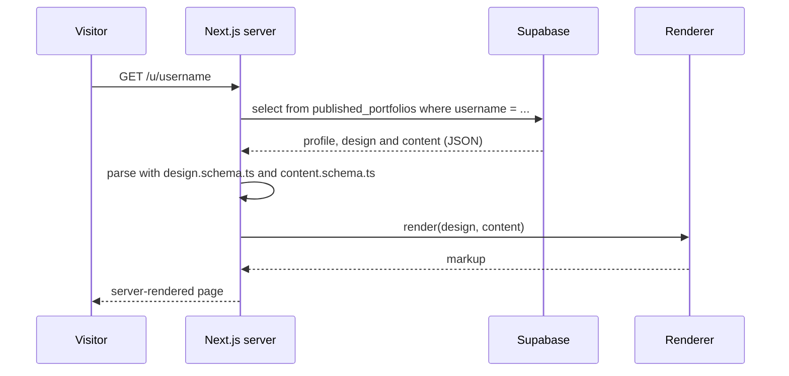
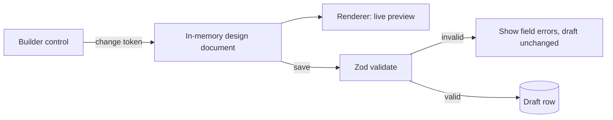
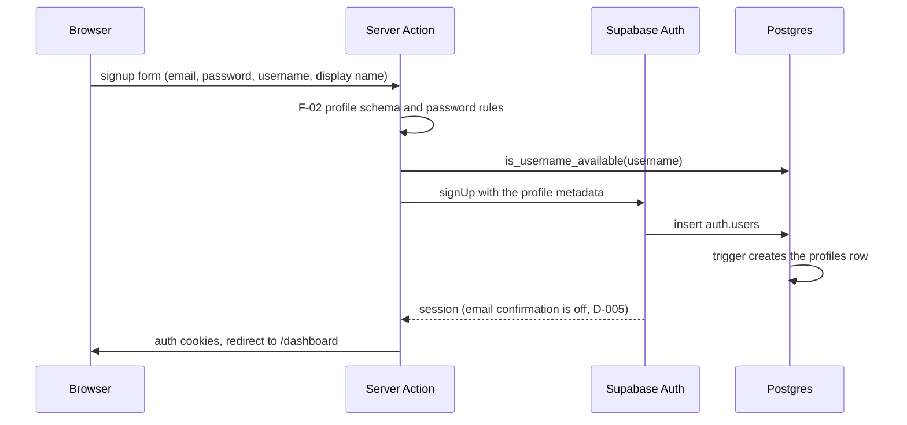

# Architecture

## Stack

| Layer | Choice | Why |
| --- | --- | --- |
| Framework | Next.js + TypeScript | Server rendering for fast, indexable public pages; one language across renderer, builder and API routes. |
| Styling | Tailwind + CSS variables | Design tokens become CSS variables, so a setting change repaints without rewriting styles; Tailwind keeps builder chrome consistent. |
| Data, auth, storage | Supabase | Postgres, Auth and Storage in one service, with row-level security doing the privacy work. |
| Validation | Zod | The schemas validate saved documents, AI output and form input. |
| Testing | Vitest | Unit tests for the schema layer now; the same runner covers later features without a browser. |
| Search | Postgres full-text search | No extra service at v1 scale; name search plus a skills join table. |
| AI | One LLM behind one interface (D-013, provider open) | Structured output mapped onto the design document; the provider stays swappable. |
| Hosting | Vercel | Matches Next.js, no configuration. |

Installed at F-02 (2026-11-03): Next.js 16.4.4, React 19.3.0, Zod 4.6.7, TypeScript 5.x, Vitest 5.1.0, Tailwind CSS 4, Node 24. Added at F-01 (2026-11-03): `@supabase/supabase-js` 2.118.0 and `@supabase/ssr` 0.12.7.

## Design as data

- One portfolio has two documents: a **design document** (theme, world, section order, display styles) and a **content document** (the text and data of each section), joined by portfolio id (D-019).
- One renderer. It takes both documents and returns the page. No other component produces page markup.
- The builder changes both. The AI changes the design document only, so it can never overwrite the owner's text.
- Consequence: a wrong-looking page is a schema problem, a renderer problem, or bad data — never a builder problem. That is what keeps four features from drifting apart in one week.

## Worlds

Two worlds, Editorial and Terminal, render the same design and content documents with different page structure, navigation and typographic treatment (F-04). Both are server components and read only the theme variables (D-043, D-047).

| Piece | Contract |
| --- | --- |
| `worlds/types.ts` | `World = { Shell, sections }`. `Shell` receives the profile, the ordered `navigation` items and the section nodes; `sections` maps each of the six section ids to a renderer. |
| `worlds/registry.ts` | Maps `editorial` and `terminal` to their worlds. The base world stays in the tree as a reference and is not registered (D-037, extended by D-043). |
| `Portfolio.tsx` | Decides which sections render, builds the navigation from them in design order, and hands both to the shell. |
| `editorial/` | Masthead shell (`data-nav="masthead"`), numbered index, magazine sections; own stylesheet. |
| `terminal/` | Explorer sidebar and tab strip (`data-nav="sidebar"`), panes, prompt headings; own stylesheet. |

**Color roles (D-044).** Every world uses the six roles the same way:

| Role | Used for |
| --- | --- |
| `background` | the page |
| `surface` | panels, cards, windows |
| `text` | primary text |
| `muted` | secondary text, labels, dates |
| `accent` | links, markers, emphasis, focus ring |
| `border` | rules, dividers, outlines |

Tints come from `color-mix()` over these variables. No world source contains a color literal (D-042, AC-5).

**Minimum bar (D-050).** A world is not done below this line: its own shell and navigation, numbered or prompt-style section headings, all six sections in every display style, the radius and color-role rules, Arabic-safe layout, and the accessibility rules. Polish — scroll and hover motion, the blinking cursor, drop caps and pull quotes, fine spacing — is cuttable first, in that order.

**Navigation and decoration.** Navigation is a labelled `nav` of anchor links to the rendered non-hero sections in design order, after a skip link to `#main-content`; it works without JavaScript (D-049). Decoration is CSS pseudo-elements and counters, or `data-decor` elements with `aria-hidden="true"`, and never user text (D-045). Worlds use logical properties only (D-048).

## Data model

Settled by D-019 to D-026 and D-053. Three tables exist after F-01; the two search tables arrive with F-09.

| Table | Holds | Policy |
| --- | --- | --- |
| `profiles` | one row per user: `id` (= the auth user), `username`, `display_name`, `headline` | owner reads and updates their own row; anonymous has no access |
| `portfolios` | the owner's private draft: `user_id` (primary key, one per user), `design` (JSONB), `content` (JSONB), `updated_at` | owner only, all four verbs |
| `published_portfolios` | the public snapshot: `user_id`, `username`, `display_name`, `headline`, `design`, `content`, `published_at`, `updated_at` | anonymous and signed-in read every row; the owner writes only their own |
| `skills` (F-09) | `id`, canonical `name`, `aliases` | proposed |
| `portfolio_skills` (F-09) | `portfolio_id`, `skill_id` — the join search and autocomplete read | proposed |

- A draft cannot leak because no policy exposes the tables that hold drafts; `published_portfolios` is the only public read path (D-053, S-1).
- `username` is unique on `lower(username)` in both `profiles` and `published_portfolios`, and a check constraint enforces the D-032 format. The reserved list stays in the application (F-02 schema), not in SQL.
- The `profiles` row is created by an `after insert` trigger on `auth.users`, from the signup metadata, inside the same transaction (D-054). The draft row is created by the app on the first dashboard load, with `ON CONFLICT DO NOTHING`.
- Username availability for the signup form is answered by `public.is_username_available(text)` (D-059): `security definer`, empty `search_path`, execute granted to `anon` and `authenticated` only, returning a boolean.
- **Design document:** `version: 1` (D-023), `world`, theme tokens, section order, display styles (D-020), and a font key from the curated enum (D-021). It contains no owner text.
- **Content document:** the data of each section. It contains no design tokens.
- The two are joined by portfolio id and are never merged (D-019).
- Profile fields sit outside both documents and are indexed by search (D-022).
- Skills are referenced by id, never by free text (D-026).
- No `direction` field in v1; Arabic text still has to render correctly inside the normal layout (D-024).
- Images live in Storage under the D-025 limits; the documents store the URL, validated as `http` or `https` (S-7).
- Publishing, and the snapshot behind "reset to last published", belong to the F-07 spec.

## Data flows

### (a) A visitor opens a public page



The select runs on the server against the public snapshot table, the only table anonymous can read (S-1). Until F-07 writes that table, the route still reads the fixture implementation of `PortfolioSource` (AC-11).

### (b) The owner edits in the builder



### (c) The AI generates a design

```mermaid
sequenceDiagram
    participant U as Owner
    participant N as Route handler
    participant L as LLM
    participant Z as Zod
    U->>N: description
    N->>N: check daily limit
    N->>L: prompt + schema
    L-->>N: JSON
    N->>Z: parse
    Z-->>N: invalid -> 422, saved data unchanged
    Z-->>N: valid -> design document
    N-->>U: preview, saved only if accepted; content untouched
```

### (d) A visitor searches

```mermaid
flowchart LR
    Q[Query: name or skill] --> N[Next.js server]
    Q --> A[Alias map: ReactJS to React]
    A --> N
    N --> F[(Postgres FTS over published portfolios)]
    F --> R[Results: name, headline, skills, link]
    R --> P[/u/username]
```

### (e) An owner signs up, logs in and logs out



Every later request passes through `src/proxy.ts`, which refreshes the session with `getClaims()` and hands the new cookies to both the request and the response. Route protection then applies the AC-6 rules, and the pages check the user again on the server, so a bypassed proxy is not a bypassed guard.

## Folder structure

Built through F-01. F-05, F-06, F-08 and F-09 add the folders marked proposed.

```
src/
  proxy.ts                            session refresh and route protection (Next 16 name for middleware)
  app/
    page.tsx                          landing page
    layout.tsx                        root layout and metadata
    not-found.tsx                     the standard 404 page
    (auth)/layout.tsx                 plain chrome for the auth pages
    (auth)/login/page.tsx             log in
    (auth)/signup/page.tsx            sign up
    (auth)/_components/               the two forms and the shared field
    dashboard/page.tsx                the signed-in home; creates the draft on first visit
    u/[username]/page.tsx             public portfolio route, metadata
    u/[username]/portfolio-content.tsx  route body, loaded behind the route's data access
    (public)/search/page.tsx          search (proposed)
    editor/                           builder and content editing (proposed)
    api/ai/generate/route.ts          AI route handler (proposed)
  schema/
    constants.ts                      enums and limits (D-028 to D-032)
    design.schema.ts                  design document, source of truth
    content.schema.ts                 content document
    profile.schema.ts                 username, display name, headline
    index.ts                          exports and the validate* helpers
    fixtures/                         valid and invalid example data
    __tests__/                        Vitest tests, named by acceptance criterion
  render/
    Portfolio.tsx                     profile + design + content to markup (D-037)
    theme.tsx                         design theme to CSS variables (D-042)
    fonts.ts                          the six fonts through next/font (D-028)
    font-vars.ts                      font key to CSS variable, no next/font import
    format.ts                         month formatting for dates
    load.ts                           username normalising, loading and validating
    types.ts                          PortfolioSource and SkillCatalog (D-036)
    primitives/                       section, tag, card, timeline item, link, paragraphs, image
    worlds/registry.ts                world key to `{ Shell, sections }` (D-043)
    worlds/types.ts                   world, shell and section contracts
    worlds/base/                      one neutral set of section components, kept as a reference
    worlds/editorial/                 Editorial shell, sections and stylesheet
    worlds/terminal/                  Terminal shell, sections and stylesheet
  data/
    index.ts                          the implementations the app imports
    fixtures/                         seven demo portfolios and the skill catalog
  portfolio/
    defaults.ts                       the default design and the empty content (D-057)
    draft.ts                          creating the draft row once (D-054)
  lib/
    supabase/config.ts                the two public environment values (D-055)
    supabase/server.ts                server client over cookies
    supabase/client.ts                browser client
    supabase/proxy.ts                 updateSession, used by src/proxy.ts
    auth/validation.ts                signup and login schemas, built on the F-02 profile schema
    auth/ports.ts                     the AuthPorts interface the logic depends on
    auth/supabase-ports.ts            its Supabase implementation
    auth/signup.ts, login.ts, logout.ts  the logic, testable with no network
    auth/actions.ts                   the Server Actions the forms call
    auth/session.ts                   getCurrentUser and getOwnProfile
    auth/redirects.ts                 the AC-6 rules as a pure function
    search/                           query building, alias map (proposed)
  design/presets/                     default design per world (proposed)
  builder/controls/                   tokens, order, display styles (proposed)
supabase/
  migrations/0001_init.sql            tables, trigger, availability function, RLS policies
  tests/rls-checklist.md              the manual checks AC-9 requires
docs/
prompts/
```

**Deviations recorded at F-03 (2026-11-03)**

- `src/render/` instead of `src/renderer/`. The folder holds the renderer, its primitives, its worlds and the load helper, so the short name matches what it contains.
- The route lives at `src/app/u/[username]/`, without the `(public)` route group. A group only earns its place when a second layout needs to differ; F-03 has one route and one layout.
- `page.tsx` is a thin shell: it exports `generateMetadata` and renders `portfolio-content.tsx`, which does the loading and the markup. Next 16 with cache components prerenders the route shell, so the data access sits behind the route's own boundary.
- `export const instant = false` on the route. Without it, `notFound()` fires after the shell has streamed, and an unknown username answers 200 with an empty body instead of the 404 page. Blocking the route keeps the 404 status honest; revisit when caching arrives.
- Tests sit next to the code they cover (`src/render/__tests__/`, `src/data/__tests__/`, `src/__tests__/`), not in a single top-level folder.

**Deviations recorded at F-01 (2026-11-03)**

- `src/proxy.ts`, not `middleware.ts`. Next.js 16 renamed the file and the export; the Supabase SSR recipe for Next 16 uses `proxy` plus `getClaims()`.
- `getCurrentUser()` calls `connection()`, and the three signed-in routes set `export const instant = false`. With cache components enabled, a route that only reads cookies when Supabase happens to be configured would be prerendered as a permanent "logged out" page.
- The auth logic sits behind the `AuthPorts` interface, so signup, login and logout are tested with fakes and no network. `actions.ts` is the only file that touches Next and Supabase.
- `src/portfolio/` rather than `src/design/presets/`: the defaults are the content of a draft row, not a design preset, and the draft code owns them.
- The username pre-check needed a SQL function (D-059) because RLS closes `profiles` to anonymous visitors, which is exactly the audience of the signup form.

## Security rules

Written as rules code can be checked against, not as intentions.

**Draft privacy (D-011)**

- S-1. The public read path is `published_portfolios` only, queried on the server. No public query reads `portfolios` or `profiles`.
- S-2. No browser query reads a table that contains drafts. In F-01 the browser client is created but never used to read data.
- S-3. `supabase/tests/rls-checklist.md` proves: anonymous reads nothing from `profiles` or `portfolios`; user A cannot read, change or delete user B's rows in any of the three tables; anonymous reads every `published_portfolios` row; user A cannot insert a published row owned by user B; and anonymous can call `is_username_available` without gaining access to `profiles`.
- S-9. The service-role key is never used (D-055). A test fails if its name appears anywhere in `src/`.

**AI (D-012)**

- S-4. The LLM key is read only inside a server route handler; it never appears in a `NEXT_PUBLIC_` variable or in client code.
- S-5. Every AI response is parsed by Zod before use; an invalid response is rejected and saved data is unchanged.
- S-6. The daily generation limit — 10 per user per day (D-025) — is enforced server-side, per user, before the LLM call.

**Input (D-014)**

- S-7. Every URL in either document is validated as `http` or `https` at schema level; `javascript:`, `data:` and other schemes are rejected there, not filtered at render time.
- S-8. Image uploads over 2 MB, or outside JPEG, PNG and WebP, are rejected (D-025).

## Sources of truth

| File | Owns |
| --- | --- |
| `src/schema/design.schema.ts` | The design document format and its validation |
| `src/schema/content.schema.ts` | The content document format and its validation |
| `src/schema/profile.schema.ts` | Username, display name and headline, outside both documents |
| `src/schema/constants.ts` | The closed enums and limits every schema imports |
| `src/render/Portfolio.tsx` | Design file to markup |
| `src/data/` | Which implementation of `PortfolioSource` and `SkillCatalog` the app uses |
| `src/portfolio/defaults.ts` | What a brand-new draft contains (D-057) |
| `src/lib/auth/` | The signup, login, logout and route-protection rules |
| `src/lib/supabase/` | The two clients and the session refresh |
| `src/proxy.ts` | Which requests are redirected, and the session refresh hook |
| `supabase/migrations/` | Tables, the profile trigger, the availability function, RLS policies |
| `supabase/tests/rls-checklist.md` | The manual proof that the policies hold |
| `DECISIONS.md` | Why anything is the way it is |
| `docs/FEATURES.md` | Scope and dependency order |
