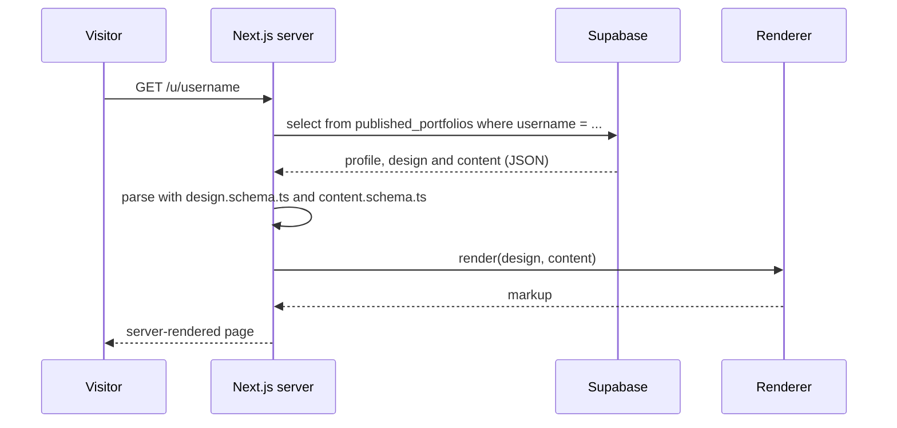
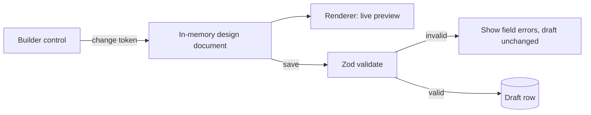
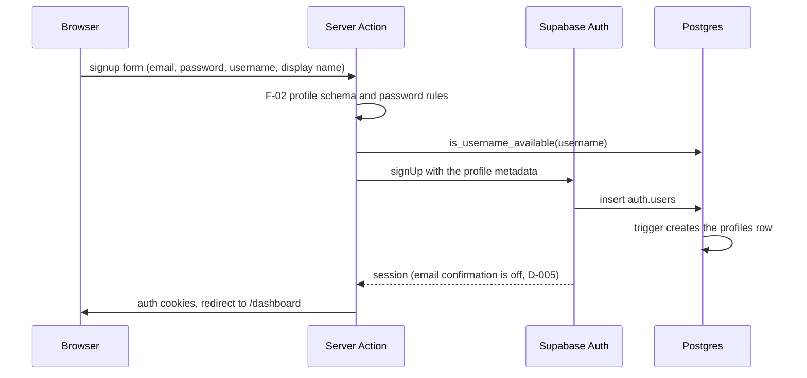
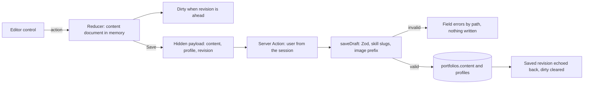
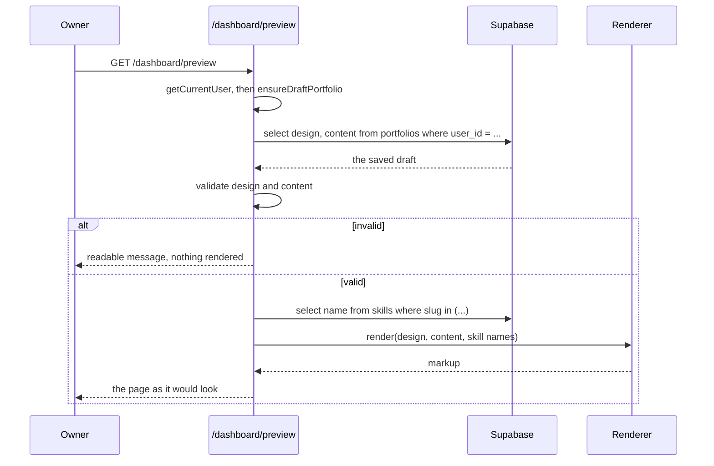
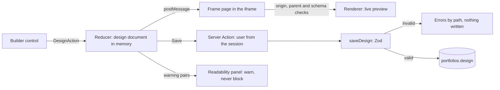
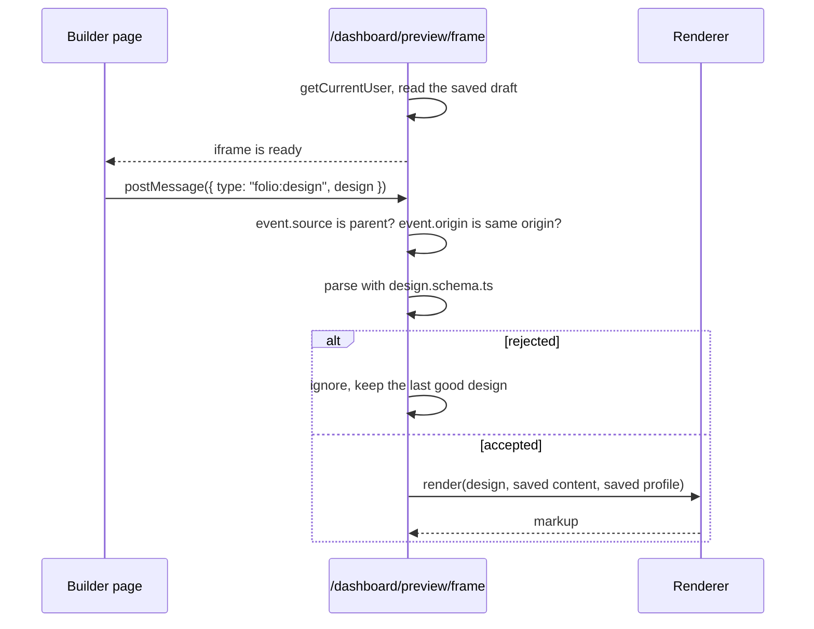

# Architecture

## Stack

| Layer | Choice | Why |
| --- | --- | --- |
| Framework | Next.js + TypeScript | Server rendering for fast, indexable public pages; one language across renderer, builder and API routes. |
| Styling | Tailwind + CSS variables | Design tokens become CSS variables, so a setting change repaints without rewriting styles; Tailwind keeps builder chrome consistent. |
| Data, auth, storage | Supabase | Postgres, Auth and Storage in one service, with row-level security doing the privacy work. |
| Validation | Zod | The schemas validate saved documents, AI output and form input. |
| Testing | Vitest | Unit tests for the schema layer now; the same runner covers later features without a browser. |
| Search | Postgres full-text search | No extra service at v1 scale; name search plus a skills join table. |
| AI | One LLM behind one interface (D-013, provider open) | Structured output mapped onto the design document; the provider stays swappable. |
| Hosting | Vercel | Matches Next.js, no configuration. |

Installed at F-02 (2026-11-03): Next.js 16.4.4, React 19.3.0, Zod 4.6.7, TypeScript 5.x, Vitest 5.1.0, Tailwind CSS 4, Node 24. Added at F-01 (2026-11-03): `@supabase/supabase-js` 2.118.0 and `@supabase/ssr` 0.12.7.

## Design as data

- One portfolio has two documents: a **design document** (theme, world, section order, display styles) and a **content document** (the text and data of each section), joined by portfolio id (D-019).
- One renderer. It takes both documents and returns the page. No other component produces page markup.
- The builder changes both. The AI changes the design document only, so it can never overwrite the owner's text.
- Consequence: a wrong-looking page is a schema problem, a renderer problem, or bad data — never a builder problem. That is what keeps four features from drifting apart in one week.

### The app chrome palette (D-071)

The screens around a portfolio — landing, signup, login, dashboard, editor, preview — are not a
world and do not read a portfolio's design document. They use one palette defined in
`src/app/globals.css`: twelve semantic tokens (`canvas`, `panel`, `ink`, `ink-soft`, `rule`,
`rule-strong`, `cta`, `cta-ink`, `danger`, `danger-surface`, `warn`, `warn-surface`), declared
once for light and once under
`prefers-color-scheme: dark`, and exposed as Tailwind utilities through `@theme inline`
(`bg-canvas`, `text-ink`, `border-rule-strong`, ...). `color-scheme` follows the same media
query so native controls match the theme.

App code names no Tailwind palette class (`text-stone-900`) and no raw color value, because a
literal cannot follow a theme: the chrome used to name `stone-*` while `globals.css` flipped the
body to near-black in dark mode, which rendered 1.04:1 text. `src/__tests__/app-chrome-colors.test.ts`
enforces the rule. A world is unaffected: `ThemeScope` still sets its own colors on the element
that wraps the rendered page (D-042).

## Worlds

Two worlds, Editorial and Terminal, render the same design and content documents with different page structure, navigation and typographic treatment (F-04). Both are server components and read only the theme variables (D-043, D-047).

| Piece | Contract |
| --- | --- |
| `worlds/types.ts` | `World = { Shell, sections }`. `Shell` receives the profile, the ordered `navigation` items and the section nodes; `sections` maps each of the six section ids to a renderer. |
| `worlds/registry.ts` | Maps `editorial` and `terminal` to their worlds. The base world stays in the tree as a reference and is not registered (D-037, extended by D-043). |
| `Portfolio.tsx` | Decides which sections render, builds the navigation from them in design order, and hands both to the shell. |
| `editorial/` | Masthead shell (`data-nav="masthead"`), numbered index, magazine sections; own stylesheet. |
| `terminal/` | Explorer sidebar and tab strip (`data-nav="sidebar"`), panes, prompt headings; own stylesheet. |

**Color roles (D-044).** Every world uses the six roles the same way:

| Role | Used for |
| --- | --- |
| `background` | the page |
| `surface` | panels, cards, windows |
| `text` | primary text |
| `muted` | secondary text, labels, dates |
| `accent` | links, markers, emphasis, focus ring |
| `border` | rules, dividers, outlines |

Tints come from `color-mix()` over these variables. No world source contains a color literal (D-042, AC-5).

**Minimum bar (D-050).** A world is not done below this line: its own shell and navigation, numbered or prompt-style section headings, all six sections in every display style, the radius and color-role rules, Arabic-safe layout, and the accessibility rules. Polish — scroll and hover motion, the blinking cursor, drop caps and pull quotes, fine spacing — is cuttable first, in that order.

**Navigation and decoration.** Navigation is a labelled `nav` of anchor links to the rendered non-hero sections in design order, after a skip link to `#main-content`; it works without JavaScript (D-049). Decoration is CSS pseudo-elements and counters, or `data-decor` elements with `aria-hidden="true"`, and never user text (D-045). Worlds use logical properties only (D-048).

## Data model

Settled by D-019 to D-026, D-053 and D-063. Three tables exist after F-01 and two more after F-05; the search join table arrives with F-09.

| Table | Holds | Policy |
| --- | --- | --- |
| `profiles` | one row per user: `id` (= the auth user), `username`, `display_name`, `headline` | owner reads and updates their own row; anonymous has no access |
| `portfolios` | the owner's private draft: `user_id` (primary key, one per user), `design` (JSONB), `content` (JSONB), `updated_at` | owner only, all four verbs |
| `published_portfolios` | the public snapshot: `user_id`, `username`, `display_name`, `headline`, `design`, `content`, `published_at`, `updated_at` | anonymous and signed-in read every row; the owner writes only their own |
| `skills` | one row per canonical skill: `slug` (primary key), `name`. Loaded from `supabase/seed/skills.sql` (D-063) | everyone reads, signed in or not; no client role can write — there is no insert, update or delete policy |
| `skill_aliases` | `alias` (primary key, lowercase), `skill_slug` (references `skills`, cascade delete). "ReactJS" and "react.js" both resolve to `react` (D-064) | same as `skills` |
| `portfolio_skills` (F-09) | `portfolio_id`, `skill_slug` — the join search reads | proposed |

- A draft cannot leak because no policy exposes the tables that hold drafts; `published_portfolios` is the only public read path (D-053, S-1).
- `username` is unique on `lower(username)` in both `profiles` and `published_portfolios`, and a check constraint enforces the D-032 format. The reserved list stays in the application (F-02 schema), not in SQL.
- The `profiles` row is created by an `after insert` trigger on `auth.users`, from the signup metadata, inside the same transaction (D-054). The draft row is created by the app on the first dashboard load, with `ON CONFLICT DO NOTHING`.
- Username availability for the signup form is answered by `public.is_username_available(text)` (D-059): `security definer`, empty `search_path`, execute granted to `anon` and `authenticated` only, returning a boolean.
- **Design document:** `version: 1` (D-023), `world`, theme tokens, section order, display styles (D-020), and a font key from the curated enum (D-021). It contains no owner text.
- **Content document:** the data of each section. It contains no design tokens.
- The two are joined by portfolio id and are never merged (D-019).
- Profile fields sit outside both documents and are indexed by search (D-022).
- Skills are referenced by slug, never by free text (D-026). The content document stores the slug; `skills` and `skill_aliases` are the only list, and a slug that is not in `skills` is refused at save time (D-033).
- The skill tables are read-only to every client role. RLS is enabled with a select policy and nothing else, so insert, update and delete are refused; the seed runs in the SQL editor as the owner, which bypasses RLS (D-063). Two triggers keep the two tables apart: an alias may not equal a skill slug, and a slug may not equal an alias.
- Images live in the public `project-images` bucket (D-065); the documents store the URL, validated as `http` or `https` at schema level (S-7) and against this project's bucket prefix at save time (D-066).

**Storage: project images (F-05).** Created by `0002_skills_and_storage.sql` (D-065).

| Piece | Setting |
| --- | --- |
| Bucket | `project-images`, public read, 2 MB limit, `image/jpeg`, `image/png`, `image/webp` (D-025) |
| Object path | `<user_id>/<uuid>.<ext>`: the first folder is the owner's id, the name is a random UUID |
| Write policies | insert, update and delete only where `(storage.foldername(name))[1] = auth.uid()::text`; anonymous has no write policy |
| Read | no select policy: the bucket is public, so the stored URL works without one (D-039) |
| Stored value | the public URL, checked at save time against this project's exact bucket prefix (D-066) |

The browser checks type and size first only so the owner gets a fast, clear message; the bucket limits are the guard (S-8). Deleting a project leaves its image in place (D-070).

## The editor (F-05)

The content editor is the first interactive surface in the app, split so every rule is testable with no browser (D-068).

| Piece | File | Contract |
| --- | --- | --- |
| Reducer | `src/editor/reducer.ts` | Pure `(state, action) => state`. Add, remove, move up and down, set field, current toggle, add and remove skill. Enforces the F-02 caps, ignores impossible moves, and never mutates the state it was given |
| Save | `src/editor/save.ts` | `saveDraft(input, deps)`. Validates the whole content document and the profile, refuses a skill slug that is not in `skills` and an image URL outside the bucket prefix, then writes through two injected functions. Imports neither Next nor Supabase |
| Server action | `src/editor/actions.ts` | `"use server"`. `saveContentAction(previous, formData)` reads the user, builds the dependencies from Supabase, calls `saveDraft` and maps the result to `SaveFormState`. The user id comes from the session, never from the form |
| Shell | `src/editor/components/editor-shell.tsx` | Client component. `useReducer` for the document, `useActionState` for the save, one hidden `payload` input carrying `{ content, profile, revision }`, the error summary and the save status |
| Skills | `src/editor/skills.ts` | `searchSkills` and `resolveSkill`. Filters the whole list in the browser by name and alias, ranks an exact alias first, and resolves an alias to its canonical slug (D-064) |
| Images | `src/editor/image-url.ts` | `imageUrlPrefix`, `isProjectImageUrl`, `checkImageFile`, `newImagePath`. Pure string work, so the bucket rules are testable with no bucket |
| Components | `src/editor/components/` | `field.tsx` (label, hint and error wiring), `section-card.tsx`, `project-list.tsx`, `experience-list.tsx`, `contact-list.tsx`, `skill-picker.tsx`, `month-year-select.tsx`, `item-actions.tsx`, `image-upload.tsx` |

How a save works, in order:

1. The shell keeps the document in the reducer and a `revision` counter that only the reducer changes. It is dirty when `revision` is greater than the revision the last successful save echoed back, so no comparison happens in an effect.
2. Submitting posts the hidden payload. `actions.ts` refuses without a session, without a profile row and without the skills list, and says which one was missing.
3. `saveDraft` validates, then writes `portfolios.content` and `profiles`. They are two statements, not one transaction, so a failure after the first is reported as exactly that rather than as a clean success.
4. Field errors come back as schema paths. The shell turns each into `field-<path>`, so the message sits next to the input that caused it, and the summary at the top takes focus.

**The preview route.** `src/app/dashboard/preview/page.tsx` reads the saved draft through `readDraftPortfolio` in `src/portfolio/draft.ts`, which answers `ok`, `missing`, `failed` or `invalid`. It then renders with the real `Portfolio` and the real skill names, so preview and the public page cannot drift apart (D-062). It never renders unsaved editor state: what it shows is what a save would have written. A draft that fails validation gets a readable message instead of a crash or a silent reset.

## Data flows

### (a) A visitor opens a public page



The select runs on the server against the public snapshot table, the only table anonymous can read (S-1). Until F-07 writes that table, the route still reads the fixture implementation of `PortfolioSource` (AC-11).

### (b) The owner edits in the builder



### (c) The AI generates a design

```mermaid
sequenceDiagram
    participant U as Owner
    participant N as Route handler
    participant L as LLM
    participant Z as Zod
    U->>N: description
    N->>N: check daily limit
    N->>L: prompt + schema
    L-->>N: JSON
    N->>Z: parse
    Z-->>N: invalid -> 422, saved data unchanged
    Z-->>N: valid -> design document
    N-->>U: preview, saved only if accepted; content untouched
```

### (d) A visitor searches

```mermaid
flowchart LR
    Q[Query: name or skill] --> N[Next.js server]
    Q --> A[Alias map: ReactJS to React]
    A --> N
    N --> F[(Postgres FTS over published portfolios)]
    F --> R[Results: name, headline, skills, link]
    R --> P[/u/username]
```

### (e) An owner signs up, logs in and logs out



Every later request passes through `src/proxy.ts`, which refreshes the session with `getClaims()` and hands the new cookies to both the request and the response. Route protection then applies the AC-6 rules, and the pages check the user again on the server, so a bypassed proxy is not a bypassed guard.

### (f) The owner edits content and saves



The browser never sends a user id. The action takes it from `getCurrentUser()`, so RLS and the action agree on whose row is written (S-10).

### (g) The owner previews the saved draft



### (h) The owner changes the design in the builder



The builder holds the whole design document in one reducer (`src/builder/reducer.ts`), the same shape the schema defines, so every control is a pure state change and every control is testable without a browser (D-068). Nothing is written until Save, and Save replaces `portfolios.design` only (D-072). A look is a named preset applied as one action (D-075); changing any single token afterwards leaves the state matching no look, which is how the gallery shows "custom".

Readability is computed from the same document, in `src/builder/contrast.ts`, over the six pairs D-076 names. It produces warnings for the panel and nothing else: `save.ts` never reads them (D-009).

### (i) The preview frame and its message protocol



Three checks guard the message (D-073): the source must be the frame's own parent, the origin must be the frame's own origin, and the design inside must pass the F-02 validator. A message that fails any of them is ignored without touching what is already rendered, so a bad message cannot blank the preview or crash the frame.

The frame page is a separate route rather than a component because media queries read the iframe's own viewport: a 375 px iframe is a 375 px viewport, so the worlds' real breakpoints fire (D-074). It renders `Portfolio` with the owner's **saved** content and profile, so the preview is always the real renderer over real data, and only the design comes over the wire.

## Folder structure

Built through F-06. F-08 and F-09 add the folders marked proposed.

```
src/
  proxy.ts                            session refresh and route protection (Next 16 name for middleware)
  app/
    page.tsx                          landing page
    layout.tsx                        root layout and metadata
    not-found.tsx                     the standard 404 page
    (auth)/layout.tsx                 plain chrome for the auth pages
    (auth)/login/page.tsx             log in
    (auth)/signup/page.tsx            sign up
    (auth)/_components/               the two forms and the shared field
    dashboard/page.tsx                the signed-in home; creates the draft on first visit
    dashboard/edit/page.tsx           the content editor (F-05); owner only
    dashboard/preview/page.tsx        the saved draft through the real renderer (F-05); owner only
    u/[username]/page.tsx             public portfolio route, metadata
    u/[username]/portfolio-content.tsx  route body, loaded behind the route's data access
    (public)/search/page.tsx          search (proposed)
    dashboard/design/page.tsx          the visual builder (F-06); owner only
    dashboard/preview/frame/page.tsx   the preview frame, driven by postMessage (F-06); owner only
    api/ai/generate/route.ts          AI route handler (proposed)
  schema/
    constants.ts                      enums and limits (D-028 to D-032)
    design.schema.ts                  design document, source of truth
    content.schema.ts                 content document
    profile.schema.ts                 username, display name, headline
    index.ts                          exports and the validate* helpers
    fixtures/                         valid and invalid example data
    __tests__/                        Vitest tests, named by acceptance criterion
  render/
    Portfolio.tsx                     profile + design + content to markup (D-037)
    theme.tsx                         design theme to CSS variables (D-042)
    fonts.ts                          the six fonts through next/font (D-028)
    font-vars.ts                      font key to CSS variable, no next/font import
    format.ts                         month formatting for dates
    load.ts                           username normalising, loading and validating
    types.ts                          PortfolioSource and SkillCatalog (D-036)
    primitives/                       section, tag, card, timeline item, link, paragraphs, image
    worlds/registry.ts                world key to `{ Shell, sections }` (D-043)
    worlds/types.ts                   world, shell and section contracts
    worlds/base/                      one neutral set of section components, kept as a reference
    worlds/editorial/                 Editorial shell, sections and stylesheet
    worlds/terminal/                  Terminal shell, sections and stylesheet
  data/
    index.ts                          the implementations the app imports
    fixtures/                         seven demo portfolios and the skill catalog
  portfolio/
    defaults.ts                       the default design and the empty content (D-057)
    draft.ts                          creating the draft row once (D-054), and readDraftPortfolio (D-062)
  editor/
    reducer.ts                        every content edit, as a pure function (D-068)
    save.ts                           validate, then write; no Next, no Supabase
    actions.ts                        the Server Action the editor form posts
    skills.ts                         search by name and alias, resolve an alias to its slug (D-064)
    image-url.ts                      the bucket prefix, the URL rule, the file check, the object path
    lib/                              shared class strings and the cn helper
    components/                       the shell, the field, the section cards and the lists
    __tests__/                        Vitest tests, named by acceptance criterion
  lib/
    supabase/config.ts                the two public environment values (D-055, D-060)
    supabase/server.ts                server client over cookies
    supabase/client.ts                browser client
    supabase/proxy.ts                 updateSession, used by src/proxy.ts
    auth/validation.ts                signup and login schemas, built on the F-02 profile schema
    auth/ports.ts                     the AuthPorts interface the logic depends on
    auth/supabase-ports.ts            its Supabase implementation
    auth/signup.ts, login.ts, logout.ts  the logic, testable with no network
    auth/actions.ts                   the Server Actions the forms call
    auth/session.ts                   getCurrentUser and getOwnProfile
    auth/redirects.ts                 the AC-6 rules as a pure function
    search/                           query building, alias map (proposed)
  builder/
    reducer.ts                        every design edit, as a pure function (D-068)
    looks.ts                          the named looks, as data (D-075)
    contrast.ts                       WCAG contrast and the six readability pairs (D-076)
    readability-copy.ts               a failing pair, said in words (AC-6)
    hex.ts                            hex input parsing and normalising (D-077)
    messages.ts                       the frame message type and its guards (D-073)
    save.ts                           validate, then write; no Next, no Supabase
    actions.ts                        the Server Actions: save and reset
    labels.ts                         the names the controls show
    components/                       the shell, color and type controls, the section list,
                                      the readability panel, the frame and the dialog
    __tests__/                        Vitest tests, named by acceptance criterion
supabase/
  migrations/0001_init.sql            tables, trigger, availability function, RLS policies
  migrations/0002_skills_and_storage.sql  skills, skill_aliases, the project-images bucket and its policies
  seed/skills.sql                     the canonical skill list and its aliases, safe to re-run
  tests/rls-checklist.md              the manual checks AC-9, AC-1 and AC-17 require
docs/
prompts/
```

**Deviations recorded at F-06 (2026-11-05)**

- `src/builder/` instead of the proposed `src/builder/controls/` plus `src/design/presets/`. The folder holds the reducer, the looks, the contrast maths, the save path and the components; a `controls/` subfolder would have held one of five siblings. The looks are data beside the reducer that applies them, not a preset of the default design.
- The builder lives at `/dashboard/design`, not the proposed `/dashboard/build`. The page edits the design document; "build" named the feature, not the document.
- The frame is `/dashboard/preview/frame`, a sibling of the saved-draft preview at `/dashboard/preview` (D-062). The two previews answer different questions — "what did I save" and "what am I editing" — and keeping the frame at its own route keeps the saved-draft page untouched.
- The frame renders the owner's saved content and profile, not fixture data, and only the design arrives over `postMessage`. Sending content too would mean serialising the whole document on every keystroke, and the builder does not edit content (D-072).
- `postMessage` carries one message type, `folio:design`. Anything else is ignored, so the frame cannot be driven by a message meant for a different feature later.

**Deviations recorded at F-05 (2026-11-05)**

- `src/editor/` sits beside `src/portfolio/`, not inside it. The portfolio folder holds the draft row and its defaults, which the server owns; the editor is browser code with a reducer, and mixing the two would put client components next to the draft's data access.
- The editor is client components, which D-047 allows because that decision restricts world components only (D-068). The save path is still a Server Action, so the browser never holds a Supabase write.
- `readDraftPortfolio` was added to `src/portfolio/draft.ts` and validates both documents on the way out. A stored draft that no longer matches the schema is refused with a message rather than reset to defaults, because resetting would delete content the owner cannot get back.
- The skills picker filters the whole list in the browser rather than querying per keystroke (D-064). The list is a few hundred rows and it is public, so the query would cost more than it saves.
- The year select uses a fixed range, 1950 to 2100, instead of "this year + 1". Reading the clock during render is an unstable value the prerenderer rejects, and a fixed range costs nothing.
- Both new pages cast the Supabase client to the draft reader interface (`supabase as unknown as DraftReader`). The structural type makes TypeScript recurse without bound (TS2589) on the generic client.

**Deviations recorded at F-03 (2026-11-03)**

- `src/render/` instead of `src/renderer/`. The folder holds the renderer, its primitives, its worlds and the load helper, so the short name matches what it contains.
- The route lives at `src/app/u/[username]/`, without the `(public)` route group. A group only earns its place when a second layout needs to differ; F-03 has one route and one layout.
- `page.tsx` is a thin shell: it exports `generateMetadata` and renders `portfolio-content.tsx`, which does the loading and the markup. Next 16 with cache components prerenders the route shell, so the data access sits behind the route's own boundary.
- `export const instant = false` on the route. Without it, `notFound()` fires after the shell has streamed, and an unknown username answers 200 with an empty body instead of the 404 page. Blocking the route keeps the 404 status honest; revisit when caching arrives.
- Tests sit next to the code they cover (`src/render/__tests__/`, `src/data/__tests__/`, `src/__tests__/`), not in a single top-level folder.

**Deviations recorded at F-01 (2026-11-03)**

- `src/proxy.ts`, not `middleware.ts`. Next.js 16 renamed the file and the export; the Supabase SSR recipe for Next 16 uses `proxy` plus `getClaims()`.
- `getCurrentUser()` calls `connection()`, and the three signed-in routes set `export const instant = false`. With cache components enabled, a route that only reads cookies when Supabase happens to be configured would be prerendered as a permanent "logged out" page.
- The auth logic sits behind the `AuthPorts` interface, so signup, login and logout are tested with fakes and no network. `actions.ts` is the only file that touches Next and Supabase.
- `src/portfolio/` rather than `src/design/presets/`: the defaults are the content of a draft row, not a design preset, and the draft code owns them.
- The username pre-check needed a SQL function (D-059) because RLS closes `profiles` to anonymous visitors, which is exactly the audience of the signup form.
- The key variable is read as `NEXT_PUBLIC_SUPABASE_PUBLISHABLE_KEY` with `NEXT_PUBLIC_SUPABASE_ANON_KEY` as a fallback, so a project set up either way works (D-060). Only emptiness is checked, and the error names the missing variable without printing its value.

## Security rules

Written as rules code can be checked against, not as intentions.

**Draft privacy (D-011)**

- S-1. The public read path is `published_portfolios` only, queried on the server. No public query reads `portfolios` or `profiles`.
- S-2. No browser query reads a table that contains drafts. The browser client is used only to upload an image to Storage (F-05); every table read and write goes through the server.
- S-3. `supabase/tests/rls-checklist.md` proves: anonymous reads nothing from `profiles` or `portfolios`; user A cannot read, change or delete user B's rows in any of the three tables; anonymous reads every `published_portfolios` row; user A cannot insert a published row owned by user B; and anonymous can call `is_username_available` without gaining access to `profiles`.
- S-9. The service-role key is never used (D-055). A test fails if its name appears anywhere in `src/`.

**AI (D-012)**

- S-4. The LLM key is read only inside a server route handler; it never appears in a `NEXT_PUBLIC_` variable or in client code.
- S-5. Every AI response is parsed by Zod before use; an invalid response is rejected and saved data is unchanged.
- S-6. The daily generation limit — 10 per user per day (D-025) — is enforced server-side, per user, before the LLM call.

**Input (D-014)**

- S-7. Every URL in either document is validated as `http` or `https` at schema level; `javascript:`, `data:` and other schemes are rejected there, not filtered at render time.
- S-8. Image uploads over 2 MB, or outside JPEG, PNG and WebP, are rejected (D-025). The bucket limits enforce it; the browser check only gives the message sooner.
- S-10. A save writes only the signed-in user's own rows. The user id comes from `getCurrentUser()`, never from the form payload, and RLS refuses anything else.
- S-11. A project `imageUrl` is accepted only when it starts with this project's exact `project-images` prefix, so a look-alike host or a URL that merely contains the prefix is refused (D-066).
- S-12. `skills` and `skill_aliases` are readable by everyone and writable by no client role: RLS is enabled with a select policy and no insert, update or delete policy (D-063). `rls-checklist.md` records the check.
- S-13. Storage writes are limited to the owner's own folder: the insert, update and delete policies on `storage.objects` require `(storage.foldername(name))[1]` to equal `auth.uid()`, and anonymous has no write policy at all (D-065).

## Sources of truth

| File | Owns |
| --- | --- |
| `src/schema/design.schema.ts` | The design document format and its validation |
| `src/schema/content.schema.ts` | The content document format and its validation |
| `src/schema/profile.schema.ts` | Username, display name and headline, outside both documents |
| `src/schema/constants.ts` | The closed enums and limits every schema imports |
| `src/render/Portfolio.tsx` | Design file to markup |
| `src/data/` | Which implementation of `PortfolioSource` and `SkillCatalog` the app uses |
| `src/portfolio/defaults.ts` | What a brand-new draft contains (D-057) |
| `src/portfolio/draft.ts` | Creating the draft row once, and reading it back for the preview (D-054, D-062) |
| `src/editor/reducer.ts` | Which content edits exist, and the limits each one enforces |
| `src/editor/save.ts` | What a save accepts, and what it writes |
| `src/editor/skills.ts` | How a query becomes a skill, by name or by alias |
| `src/editor/image-url.ts` | Which image URLs and files are accepted |
| `supabase/seed/skills.sql` | The canonical skill list and its aliases (D-063) |
| `src/lib/auth/` | The signup, login, logout and route-protection rules |
| `src/lib/supabase/` | The two clients and the session refresh |
| `src/proxy.ts` | Which requests are redirected, and the session refresh hook |
| `supabase/migrations/` | Tables, the profile trigger, the availability function, RLS policies, the skill tables, the storage bucket |
| `supabase/tests/rls-checklist.md` | The manual proof that the policies hold |
| `DECISIONS.md` | Why anything is the way it is |
| `docs/FEATURES.md` | Scope and dependency order |
