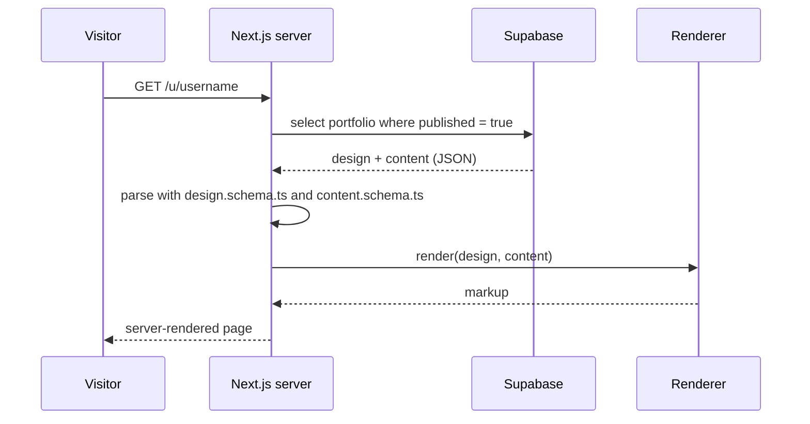
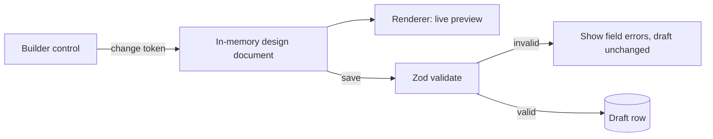

# Architecture

## Stack

| Layer | Choice | Why |
| --- | --- | --- |
| Framework | Next.js + TypeScript | Server rendering for fast, indexable public pages; one language across renderer, builder and API routes. |
| Styling | Tailwind + CSS variables | Design tokens become CSS variables, so a setting change repaints without rewriting styles; Tailwind keeps builder chrome consistent. |
| Data, auth, storage | Supabase | Postgres, Auth and Storage in one service, with row-level security doing the privacy work. |
| Validation | Zod | The schemas validate saved documents, AI output and form input. |
| Testing | Vitest | Unit tests for the schema layer now; the same runner covers later features without a browser. |
| Search | Postgres full-text search | No extra service at v1 scale; name search plus a skills join table. |
| AI | One LLM behind one interface (D-013, provider open) | Structured output mapped onto the design document; the provider stays swappable. |
| Hosting | Vercel | Matches Next.js, no configuration. |

Installed at F-02 (2026-11-03): Next.js 16.4.4, React 19.3.0, Zod 4.6.7, TypeScript 5.x, Vitest 5.1.0, Tailwind CSS 4, Node 24.

## Design as data

- One portfolio has two documents: a **design document** (theme, world, section order, display styles) and a **content document** (the text and data of each section), joined by portfolio id (D-019).
- One renderer. It takes both documents and returns the page. No other component produces page markup.
- The builder changes both. The AI changes the design document only, so it can never overwrite the owner's text.
- Consequence: a wrong-looking page is a schema problem, a renderer problem, or bad data — never a builder problem. That is what keeps four features from drifting apart in one week.

## Data model

Settled by D-019 to D-026. The table layout below is a proposal for F-02 and F-09; the decisions are what bind.

| Table | Holds | From |
| --- | --- | --- |
| `profiles` | one row per user: `username` (unique, reserved list blocked), `display_name`, `headline` | D-006, D-022 |
| `portfolios` | `id`, `owner_id`, `design` (JSONB, the design document), `content` (JSONB, the content document), publish state | D-007, D-019 |
| `skills` | `id`, canonical `name`, `aliases` | D-026 |
| `portfolio_skills` | `portfolio_id`, `skill_id` — the join search and autocomplete read | D-010, D-026 |

- **Design document:** `version: 1` (D-023), `world`, theme tokens, section order, display styles (D-020), and a font key from the curated enum (D-021). It contains no owner text.
- **Content document:** the data of each section. It contains no design tokens.
- The two are joined by portfolio id and are never merged (D-019).
- Profile fields sit outside both documents and are indexed by search (D-022).
- Skills are referenced by id, never by free text (D-026).
- No `direction` field in v1; Arabic text still has to render correctly inside the normal layout (D-024).
- Images live in Storage under the D-025 limits; the documents store the URL, validated as `http` or `https` (S-7).
- Publish state, and the snapshot behind "reset to last published", belong to the F-07 spec, not to this document.

## Data flows

### (a) A visitor opens a public page



The select in step 2 runs on the server and is scoped to published rows (S-1).

### (b) The owner edits in the builder



### (c) The AI generates a design

```mermaid
sequenceDiagram
    participant U as Owner
    participant N as Route handler
    participant L as LLM
    participant Z as Zod
    U->>N: description
    N->>N: check daily limit
    N->>L: prompt + schema
    L-->>N: JSON
    N->>Z: parse
    Z-->>N: invalid -> 422, saved data unchanged
    Z-->>N: valid -> design document
    N-->>U: preview, saved only if accepted; content untouched
```

### (d) A visitor searches

```mermaid
flowchart LR
    Q[Query: name or skill] --> N[Next.js server]
    Q --> A[Alias map: ReactJS to React]
    A --> N
    N --> F[(Postgres FTS over published portfolios)]
    F --> R[Results: name, headline, skills, link]
    R --> P[/u/username]
```

## Proposed folder structure

A proposal only. Nothing below is created yet.

```
src/
  app/
    (public)/u/[username]/page.tsx    public portfolio
    (public)/search/page.tsx          search
    (auth)/login/                     log in
    (auth)/signup/                    sign up
    editor/                           builder and content editing
    api/ai/generate/route.ts          AI route handler
  schema/
    constants.ts                      enums and limits (D-028 to D-032)
    design.schema.ts                  design document, source of truth
    content.schema.ts                 content document
    profile.schema.ts                 username, display name, headline
    index.ts                          exports and the validate* helpers
    fixtures/                         valid and invalid example data
    __tests__/                        Vitest tests, named by acceptance criterion
  design/
    presets/                          default design per world
  renderer/
    Renderer.tsx                      design + content to markup
    sections/                         shared section primitives
    worlds/editorial/                 world-specific components
    worlds/terminal/
  builder/
    controls/                         tokens, order, display styles
  lib/
    supabase/server.ts                server client, scoped reads
    supabase/client.ts                browser client, owner writes
    search/                           query building, alias map
supabase/
  migrations/                         tables, RLS policies, seed
docs/
prompts/
```

## Security rules

Written as rules code can be checked against, not as intentions.

**Draft privacy (D-011)**

- S-1. Public page and search read only rows where `published = true`, through a server-side Supabase client.
- S-2. No anon-key query from the browser reads a table that contains draft rows.
- S-3. A test asserts that an unauthenticated request for an unpublished draft returns 404, and that an anon-key select on portfolios returns no draft rows.

**AI (D-012)**

- S-4. The LLM key is read only inside a server route handler; it never appears in a `NEXT_PUBLIC_` variable or in client code.
- S-5. Every AI response is parsed by Zod before use; an invalid response is rejected and saved data is unchanged.
- S-6. The daily generation limit — 10 per user per day (D-025) — is enforced server-side, per user, before the LLM call.

**Input (D-014)**

- S-7. Every URL in either document is validated as `http` or `https` at schema level; `javascript:`, `data:` and other schemes are rejected there, not filtered at render time.
- S-8. Image uploads over 2 MB, or outside JPEG, PNG and WebP, are rejected (D-025).

## Sources of truth

| File | Owns |
| --- | --- |
| `src/schema/design.schema.ts` | The design document format and its validation |
| `src/schema/content.schema.ts` | The content document format and its validation |
| `src/schema/profile.schema.ts` | Username, display name and headline, outside both documents |
| `src/schema/constants.ts` | The closed enums and limits every schema imports |
| `src/renderer/Renderer.tsx` | Design file to markup |
| `src/design/presets/` | Default design per world |
| `supabase/migrations/` | Tables, RLS policies, seed data |
| `DECISIONS.md` | Why anything is the way it is |
| `docs/FEATURES.md` | Scope and dependency order |
